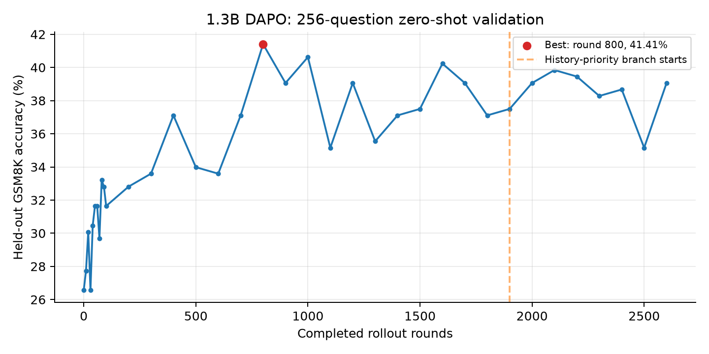

# DeepSeekMath Small · 单卡数学推理训练实验

在一张 NVIDIA GB300（约 251 GiB 显存）上，使用小型 Coder 模型学习数学继续预训练、监督微调和可验证奖励强化学习的完整流程。主线模型为 **DeepSeek-Coder-1.3B-Base**；同时保留 Qwen2.5-Coder-1.5B 的早期对照、数值诊断、失败和恢复记录。

这个仓库是训练工作区的发布快照：**主要保留代码、配置、实验数值和日志**。CPT 和 SFT 已完成；DAPO 原计划累计 10,000 轮，已按用户要求在 **2,652 轮**后保存完整检查点并停止，共 **10,608 次梯度更新、84,864 个实际用于更新的有效组**。最终进度、停止记录与曲线见 [结果快照](docs/results.md)。

## 训练工作

| 阶段 | 设置与产出 |
|---|---|
| 数学 CPT | OpenWebMath 约 5B token 数据，训练 10B input token；全参数训练，确定性数据顺序、分片与验证隔离 |
| SFT | GSM8K + MATH；14,459 条训练、512 条验证；答案和 EOS 计算 loss，最长 4,096 token；3 epoch，选中第 2 epoch 检查点 |
| DAPO | GSM8K；每题 8 个回答，每轮使用 32 个混合对错组；每轮 4 次 optimizer update；生成上限 2,048 token |
| 单卡优化 | 完成回答移出解码 batch；microbatch 调优；历史难度路由；数值对照、GPU profiling、恢复审计 |

主线使用 FP32 参数、梯度和 Adam 状态，BF16 autocast 计算。RL 学习率为 `1e-6`，前 10 轮 warmup；后续使用 **75% 历史优先选题 + 25% 随机探索**。该选题策略有意改变训练题分布。

## 已完成的全量评测

下表使用相同的官方 few-shot CoT 协议、greedy、1,024 token 上限；GSM8K 1,319 题，MATH 5,000 题，错误与超时计入分母。

| 模型检查点 | GSM8K | MATH |
|---|---:|---:|
| 原始 DeepSeek-Coder-1.3B | 4.78% | 4.16% |
| 数学 CPT 10B | 8.64% | 5.64% |
| SFT 最佳检查点 | 21.30% | 6.14% |
| 首次 100 轮 RL 实验选中的第 80 轮 | 23.73% | 5.34% |

最后一行是**早期 RL 检查点**。长训练使用的 256 题、zero-shot GSM8K 验证分数单独记录，不与本表混用。RL 对 GSM8K 的提升伴随这一早期检查点 MATH 分数下降；长训练的最终轮与最佳验证检查点尚未重新进行全量测试。



[完整结果与限制](docs/results.md) · [实验目录索引](docs/experiments.csv) · [数据处理与训练方法](docs/methodology.md)

## 目录

```text
scripts/             数据处理、CPT / SFT / DAPO、评测、绘图、诊断和测试
configs/             历史配置、依赖锁定记录、协议与学习率计划
runs/                各实验的数值、日志、报告和当时的 source 快照
  */checkpoint_metadata/  检查点描述；不包含权重或优化器张量
  */*rollout_metrics*      rollout 的长度、奖励、正确率、筛选统计
  */*.partNNNN.gz         大日志的压缩分片
logs/                工作区早期诊断 stdout
data/                仅保留数据 manifest；不包含数据正文与 token 数组
tools/               日志解压、快照检查、结果与图表生成工具
docs/                结果、方法、实验索引、图表和本次整理的检查结果
EXPORT_MANIFEST.json 原文件快照与导出文件的 SHA256 对照
RELEASE_MANIFEST.json 发布目录各文件的 SHA256 清单
```

原实验目录名称保留，便于追溯。`runs/*/source/` 和历史 launcher 用于查看当时实现及启动参数；新的实验请使用 `scripts/` 下的 CLI，并指定新的输出目录。

## 先查看结果或运行 CPU 检查

记录的环境为 Python 3.12、PyTorch 2.9.1+cu130、Transformers 4.55.4。CUDA 相关依赖与完整环境记录见 `configs/requirements.lock.txt`。在已有兼容 PyTorch 环境中：

```bash
python -m pip install -r requirements.txt
python -m pip install -r requirements-analysis.txt
python -m unittest discover -s scripts -p 'test_*.py'
python tools/validate_release.py
python tools/build_results.py
```

需要真实模型或数据的两项历史集成测试在缺少资产时会明确跳过。常规 CPU 测试覆盖学习率、数据顺序、恢复、PPO clipping、group 计数、解码及取消规则。

大日志保留为 gzip 分片，按清单可恢复为可供原绘图脚本读取的文件：

```bash
python tools/materialize_logs.py --pattern 'runs/deepseek_coder_1p3b_10b_20261012/training.jsonl'
python tools/materialize_logs.py --pattern 'runs/*/gpu_samples.jsonl'
```

这会解压**导出后的内容**。解压文件会登记为本地派生文件，并加入本地 Git 排除列表。逐题正文已被移除的统计文件无法借此还原原始题目、生成文本或 token ID。

## 训练与评测入口

权重和数据需要另外下载、准备。运行训练前从仓库根目录执行，使用独立的输出目录：

```bash
python scripts/download_openwebmath.py --help
python scripts/prepare_openwebmath_large.py --help
python scripts/prepare_deepseek_coder_pilot.py --help
python scripts/extend_deepseek_coder_data.py --help
python scripts/train_cpt.py --help
python scripts/prepare_math_sft.py --help
python scripts/train_math_sft.py --help
python scripts/dapo_math.py --help
python scripts/run_math_inference.py --help
```

历史精确启动链、分阶段扩充数据、resume 参数和源代码哈希保留在 `runs/*_setup/`、`runs/*_launch/`。部分 CLI 会校验原始数据与检查点血缘；单独取得代码不等于取得这些资产。准备新的数据后需要生成自己的 manifest 和训练产物。

官方评测依赖另行获取，未在本仓库复制：

```bash
git clone https://github.com/deepseek-ai/DeepSeek-Math.git vendor/DeepSeek-Math
git -C vendor/DeepSeek-Math checkout b8b0f8ce093d80bf8e9a641e44142f06d092c305
```

相关依赖见 `requirements-eval.txt`。逐题评测输出保留正确性、长度、类别、耗时和失败统计；完整生成文本留在原工作区，因此本发布包不能直接重新判分原始生成。

## 结果边界与记录原则

- 这是单卡、小模型、小数据的流程学习实验；模型、数据组成和预算均与论文设置不同。
- SFT 与 RL 均使用过 GSM8K 训练题；不作未见任务泛化或单独归因于 RL 的结论。
- 仅做所述精确去重和重叠检查，没有完整的语义去重或 CPT 测试集污染排查。
- 早期 Qwen CPT 出现验证 loss 回升与推理退化；保留原生 / 优化对照、学习率试验及失败记录。
- 64 路小并发下历史路由约 3.50 倍；正式 256 路匹配权重对比约 **1.88 倍有效组产出速度**。这属于短期采样对比，长期有效组比例下降后速度也下降，不能当作全程恒定加速。
- 已尝试长尾提前结束；小试验没有触发取消且未显示额外收益，本次正式训练未启用。
- RL 中曾因候选组上限退出并回退到已保存检查点；失败分支、重跑量和累计 group 口径均保留，见 `runs/dapo_execution_ledger.json`。

源文件中的机器绝对路径已改为相对路径或 `/external/...` 占位。历史 SHA256 描述原始字节；导出后的 SHA256 单独记录，不能对路径修改后的源码直接套用历史哈希。

参考：[DeepSeekMath](https://arxiv.org/abs/2402.03300) · [DAPO](https://arxiv.org/abs/2503.14476) · [OpenWebMath](https://huggingface.co/datasets/open-web-math/openwebmath) · [DeepSeek-Coder-1.3B-Base](https://huggingface.co/deepseek-ai/deepseek-coder-1.3b-base)

重新生成图表或修改发布文件后，用 `python tools/validate_release.py --write-manifest` 更新发布清单。历史配置中的 SHA256 始终保留原始口径。
