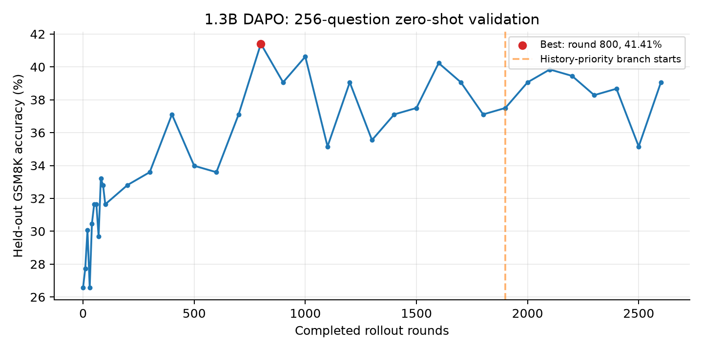

# DeepSeekMath Small：单卡数学推理全流程

在一张 **NVIDIA GB300（约 251 GiB 显存）** 上，用 **DeepSeek-Coder-1.3B-Base** 跑通数学继续预训练（CPT）→ 监督微调（SFT）→ DAPO 强化学习的完整流程，并把 GSM8K 从 **4.78%** 提升到 **23.73%**。重点不是刷榜，而是验证**单卡训练与 rollout 采样效率**：哪些优化真的省时间，哪些只是看起来省。

仓库是训练工作区的发布快照：保留代码、配置、聚合数值、日志与审计记录，不包含权重、数据正文和逐题生成文本。

---

## 主要结论（Summary）

1. **单卡跑通三阶段全流程。** CPT 训练 **10B input token**（OpenWebMath 约 5B 语料两遍），SFT 14,459 条样本 / 1,356 steps，DAPO 完成 **2,652 轮 / 10,608 次梯度更新 / 84,864 个有效组**；全程一张 GB300。
2. **GSM8K 4.78% → 23.73%。** CPT 后 8.64%，SFT 后 21.30%，早期 RL（第 80 轮）23.73%。同一批检查点的 MATH 为 4.16% → 5.64% → 6.14% → **5.34%**：RL 早期 GSM8K 提升伴随 MATH 回落，这个负结果保留在表里。
3. **长 RL 的独立验证。** 256 题 held-out GSM8K、zero-shot、2,048 token：最佳第 800 轮 **41.41%**（106/256），第 2,600 轮 **39.06%**（100/256）。最终轮与最佳验证检查点尚未做全量 GSM8K + MATH 复测。
4. **rollout 吞吐优化。** 完成回答即时移出解码 batch、microbatch 调到 16（4×64 response minibatch）、用 GPU profiling 定位解码瓶颈；最近 100 轮约 **265 秒/轮（13.6 轮/小时）**。
5. **按历史难度路由选题。** 75% 历史优先 + 25% 随机探索；256 路匹配权重对比下有效组产出速度约 **1.88 倍**（uniform 108.23 s vs history 57.63 s），64 路小并发约 3.50 倍。这是短期采样对比，长期有效组比例下降后倍率不保持。
6. **可审计的发布快照。** `EXPORT_MANIFEST.json` / `RELEASE_MANIFEST.json` 记录 SHA256，CPU 测试覆盖学习率、恢复、PPO clipping、组计数和解码规则；失败回退与重跑量单独记账。

---

## 1. 实验设置

| 项 | 设置 |
|---|---|
| 模型 | DeepSeek-Coder-1.3B-Base（另保留 Qwen2.5-Coder-1.5B 早期对照与失败记录） |
| 硬件 | 单张 NVIDIA GB300，约 251 GiB 显存 |
| CPT | OpenWebMath 固定 revision，约 5B token 语料，训练 10B input token；全参数训练，确定性数据顺序 |
| SFT | GSM8K + MATH；14,459 条训练、512 条验证；答案 + EOS 计算 loss，最长 4,096 token；3 epoch，取第 2 epoch 最佳检查点（step 904，val loss 0.7081） |
| RL | GSM8K；每题 8 个回答；每轮 32 个混合对错组（256 条回答）；每轮 4 次 optimizer update；生成上限 2,048 token；lr 1e-6，前 10 轮 warmup |
| 精度 | FP32 参数 / 梯度 / Adam 状态，BF16 autocast 计算 |
| 全量评测 | GSM8K 1,319 题、MATH 5,000 题；官方 few-shot CoT、greedy、1,024 token，错误与超时计入分母 |

---

## 2. 训练结果

### 2.1 三阶段主线

| 阶段 | 状态与数值 |
|---|---|
| 数学 CPT | 10,000,000,000 input token；验证 loss **2.1084 → 1.7537** |
| SFT | 1,356 steps；最佳 step 904，验证 loss **0.7081** |
| DAPO | 2,652 / 10,000 轮；**10,608** 次梯度更新；实际使用 **84,864** 个有效组 |

### 2.2 全量测试（统一 1,024 token）

| 检查点 | GSM8K 正确数 / 1,319 | MATH 正确数 / 5,000 |
|---|---:|---:|
| 原始 DeepSeek-Coder-1.3B | 63（**4.78%**） | 208（**4.16%**） |
| 数学 CPT 10B | 114（**8.64%**） | 282（**5.64%**） |
| SFT 最佳 step 904 | 281（**21.30%**） | 307（**6.14%**） |
| 早期 RL 第 80 轮 | 313（**23.73%**） | 267（**5.34%**） |

最后一行是早期 RL 检查点，不是长训练的最终成绩。长训练使用另一套 256 题、zero-shot、2,048 token 的 held-out 验证，两套数字不能直接比较。

### 2.3 长 RL 的 held-out 验证

256 题 held-out GSM8K，zero-shot / greedy / EOS-only / 2,048 token：

| 轮数 | 1,900 | 2,000 | 2,100 | 2,200 | 2,300 | 2,400 | 2,500 | 2,600 |
|---|---:|---:|---:|---:|---:|---:|---:|---:|
| 正确数 / 256 | 96 | 100 | 102 | 101 | 98 | 99 | 90 | 100 |
| 正确率 | 37.50% | 39.06% | 39.84% | 39.45% | 38.28% | 38.67% | 35.16% | 39.06% |

最佳为第 800 轮的 **41.41%**（106/256）；最近 100 轮平均 265.0 秒/轮，候选中混合对错组占 4.45%。



---

## 3. 单卡 rollout 优化

### 3.1 解码与训练吞吐

- **完成回答即时移出解码 batch**：不等整批最长序列结束，已完成的回答不再参与后续 decode 步。当前版本没有实现完整的 continuous batching（持续补题）。
- **microbatch 调优**：每轮 32 组、256 条回答，先重算整批 old log probabilities，再切成 4 个 64-response minibatch，microbatch 取 16。
- **GPU profiling**：用 profiler 定位 decode 阶段的耗时分布，再决定优化顺序；没有把 CPU 观测或队列等待混进 decode 计时。

### 3.2 历史难度路由

- 每批构造确定性候选池，对每题历史正确率做 EMA 更新；**25% 回答组随机探索，75% 优先选择历史上仍有正确/错误分歧的题**。被跳过的 proposal 不执行推理，单独计数。
- 同一第 1,900 轮权重、正式 256 路采样、每次凑齐 32 个有效组：

  | 策略 | 耗时 | 有效组比例 |
  |---|---:|---:|
  | uniform | 108.23 s | 10.31% |
  | history_rank | **57.63 s** | **28.12%** |

  短期有效组产出速度约 **1.88 倍**；训练继续后大量题目变成全对，有效组比例下降，长期速度不保持这个倍率。
- 另测过“按已完成正确回答长度的中位数 / batch p90 提前取消长回答”，小试验没有触发取消且无额外收益，正式训练未启用。

---

## 4. 复现与仓库结构

```text
scripts/             数据处理、CPT / SFT / DAPO、评测、绘图、诊断和测试
configs/             历史配置、依赖锁定记录、协议与学习率计划
runs/                各实验数值、日志、报告和当时的 source 快照
  */checkpoint_metadata/  检查点描述；不含权重或优化器张量
  */*rollout_metrics*     rollout 长度、奖励、正确率、筛选统计
logs/                早期诊断 stdout
data/                仅数据 manifest；不含正文与 token 数组
tools/               日志解压、快照检查、结果与图表生成
docs/                结果、方法、实验索引、图表
EXPORT_MANIFEST.json 原始 / 导出文件的 SHA256 对照
RELEASE_MANIFEST.json 发布目录的 SHA256 清单
```

环境记录为 Python 3.12、PyTorch 2.9.1+cu130、Transformers 4.55.4。CPU 侧自检：

```bash
python -m pip install -r requirements.txt -r requirements-analysis.txt
python -m unittest discover -s scripts -p 'test_*.py'
python tools/validate_release.py
python tools/build_results.py
```

训练入口（权重与数据需自行准备）：

```bash
python scripts/train_cpt.py --help
python scripts/train_math_sft.py --help
python scripts/dapo_math.py --help
python scripts/run_math_inference.py --help
```

大日志按 gzip 分片保存，可用 `tools/materialize_logs.py` 还原为绘图脚本可读的格式；逐题正文已移除，无法据此还原原始题目或生成文本。

---

## 5. 局限

- **单卡、小模型、小数据**的流程学习实验，模型、数据组成和预算都与论文设置不同，不能当作方法有效性的论文级证据。
- **GSM8K 训练题同时用于 SFT 和 RL**，不做“未见任务泛化”或“RL 单独带来提升”的归因；只做了精确去重和重叠检查，没有完整语义去重或 CPT 污染排查。
- **早期 RL 的 MATH 分数下降**（6.14% → 5.34%）是真实结果；长训练的最终轮和最佳验证检查点尚未做全量复测。
- **1.88 倍是短期采样对比**，不是全程恒定加速；长期有效组比例下降后倍率会回落。
- RL 中曾因候选组上限退出并回滚到已保存检查点，失败分支与重跑量记录在 `runs/dapo_execution_ledger.json`；这些不计入主线 2,652 轮。
- 权重、Adam 张量、数据正文、token 数组和原始 rollout 解答不在发布包中。

---

## 参考

[DeepSeekMath](https://arxiv.org/abs/2402.03300) · [DAPO](https://arxiv.org/abs/2503.14476) · [OpenWebMath](https://huggingface.co/datasets/open-web-math/openwebmath) · [DeepSeek-Coder-1.3B-Base](https://huggingface.co/deepseek-ai/deepseek-coder-1.3b-base)

结果细节见 [docs/results.md](docs/results.md)，数据与训练方法见 [docs/methodology.md](docs/methodology.md)，实验索引见 [docs/experiments.csv](docs/experiments.csv)。
