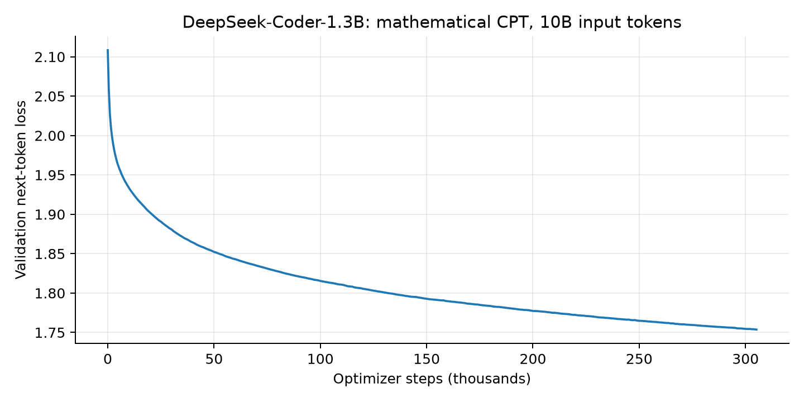
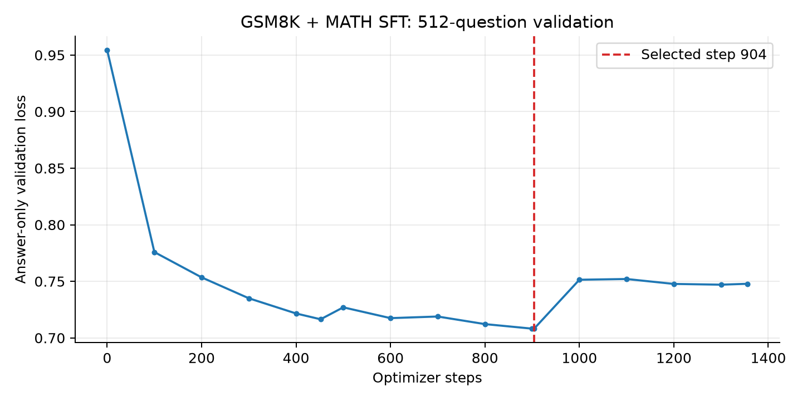

# 结果快照

快照窗口（UTC）：2026-10-18T15:06:01.091420+00:00 ～ 2026-10-18T15:09:36.897614+00:00。训练工作区仍在运行；本目录是静态记录。

## 主线结果

| 阶段 | 状态与数值 |
|---|---|
| DeepSeek CPT | 10,000,000,000 input token；验证 loss 2.1084 → 1.7537 |
| SFT | 1,356 steps；最佳 step 904，验证 loss 0.7081 |
| RL | 已记录 2,411 / 10,000 轮；9,644 次梯度更新；实际使用 77,152 个有效组 |

当前 RL 轨迹计数不包含回退后丢弃的正式训练分支。相关执行量见 `runs/dapo_execution_ledger.json`；短跑的 disposable 更新单独标记。

## 完整测试，统一 1,024 token

| 检查点 | GSM8K 正确数 / 1,319 | MATH 正确数 / 5,000 |
|---|---:|---:|
| Original DeepSeek-Coder-1.3B | 63 (4.78%) | 208 (4.16%) |
| CPT10B | 114 (8.64%) | 282 (5.64%) |
| SFT best step904 | 281 (21.30%) | 307 (6.14%) |
| Early RL round80 | 313 (23.73%) | 267 (5.34%) |

这些是原始完整测试记录。选择性 2,048 token 补测另见 `runs/deepseek_length2048_20261015/report/` 和 `runs/deepseek_sft_length2048_20261015/report/`，不混入上表。

## 长 RL 的独立验证曲线

256 题 held-out GSM8K，zero-shot / greedy / EOS-only / 2,048 token。最佳第 800 轮：106/256 = 41.41%。最近第 2400 轮：99/256 = 38.67%。

| 轮数 | 正确数 / 256 | 正确率 |
|---|---:|---:|
| 1700 | 100 | 39.06% |
| 1800 | 95 | 37.11% |
| 1900 | 96 | 37.50% |
| 2000 | 100 | 39.06% |
| 2100 | 102 | 39.84% |
| 2200 | 101 | 39.45% |
| 2300 | 98 | 38.28% |
| 2400 | 99 | 38.67% |

最近 100 轮平均 205.8 秒/轮，约 17.5 轮/小时；候选中混合对错组占 6.83%。这只描述快照前的实际速度，不推断后续恒定吞吐。

## 短期性能对照

同一第 1,900 轮权重，正式 256 路采样，每次凑齐 32 个有效组：

| 策略 | 耗时 | 有效组比例 |
|---|---:|---:|
| uniform | 108.23 s | 10.31% |
| history_rank | 57.63 s | 28.12% |

历史优先路由的这一短期有效组产出速度约为 1.88 倍。训练继续后大量题目变为全对，有效组比例下降，长期速度并未保持这一倍率。64 题、4 update 的 execution probe 也不能证明能力保持。

## CPT / SFT 验证

## 阅读数值时的限制

单种子、小模型、缩小语料；GSM8K 训练题已用于 SFT 与 RL；只有所述精确重叠检查；CPT 没有完整测试集去污染。当前最佳 RL 验证检查点尚不能视为完整测试成绩。早期 RL 检查点的 MATH 测试分数下降也保留在上表。
